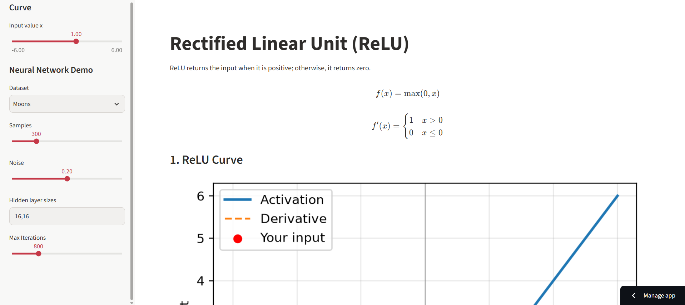
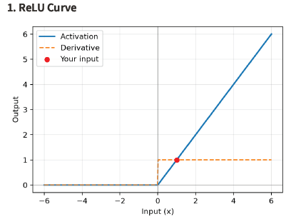
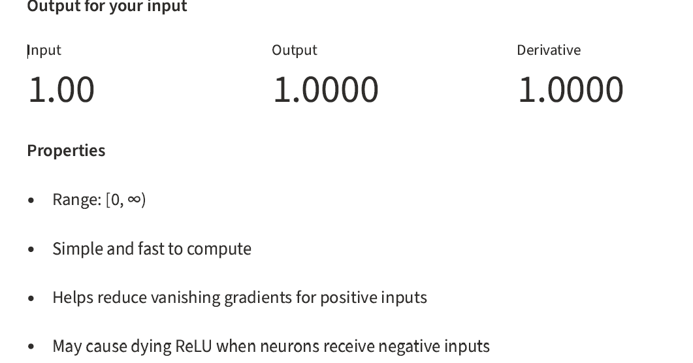

# Neural Network Activation Function Visualiser (ReLU, Sigmoid and Tanh)

**BSD3513 – Introduction to Artificial Intelligence | Lab Report 4**

## Project Overview

This project contains three separate Streamlit applications that visualise commonly used activation functions in artificial neural networks:

1. **Rectified Linear Unit (ReLU)** – `relu_app.py`
2. **Sigmoid** – `sigmoid_app.py`
3. **Hyperbolic Tangent (Tanh)** – `tanh_app.py`

Each application displays the activation function and its derivative, lets users change the input value, and demonstrates an MLP classifier using the corresponding activation function.

## Live Applications

Replace the placeholders with your own Streamlit deployment URLs.

| Application | Live URL |
|---|---|
| ReLU | https://lab-report-4-vtmlhlywqsecapppzywmda.streamlit.app/ |
| Sigmoid | http://lab-report-4-grq2qq9xyssmtt3ey3qvnx.streamlit.app/ |
| Tanh | https://lab-report-4-ggn2ys4ft7c4t8w8ezeimp.streamlit.app/ |

## Features

- Mathematical formula and derivative for each activation function.
- Interactive activation curve plotted over an input range from -6 to 6.
- Input slider to explore different input values.
- Output metrics showing the input, activation output and derivative.
- Explanation of each function's range, advantages and limitations.
- MLP classification demonstration using a synthetic Moons or Circles dataset.
- Decision-boundary visualisation and displayed model accuracy.
- Fixed random seed (`42`) to support reproducibility.

## Sidebar Settings

| Setting | Description |
|---|---|
| Input value x | Value passed into the activation function. |
| Dataset | Selects Moons or Circles. |
| Samples | Controls the number of generated data points. |
| Noise | Controls the noise level in the synthetic dataset. |
| Hidden layer sizes | Sets neurons per hidden layer, e.g. `16,16`. |
| Max Iterations | Sets the maximum number of MLP training iterations. |

## Activation Function Summary

| Function | Formula | Derivative | Output range |
|---|---|---|---|
| ReLU | `max(0, x)` | `1` if `x > 0`, otherwise `0` | `[0, ∞)` |
| Sigmoid | `1 / (1 + e^(-x))` | `f(x)(1 - f(x))` | `(0, 1)` |
| Tanh | `tanh(x)` | `1 - tanh²(x)` | `(-1, 1)` |

## Screenshots

Add screenshots captured from your own applications to the `screenshots/` folder.

### ReLU






### Sigmoid


### Tanh


## Run Locally

### 1. Download or clone the repository

```bash
git clone [Paste your GitHub repository URL]
cd [Your repository folder]
```

Alternatively, download the repository ZIP from GitHub and extract it.

### 2. Install dependencies

```bash
pip install -r requirements.txt
```

### 3. Run each application separately

```bash
streamlit run relu_app.py
```

```bash
streamlit run sigmoid_app.py
```

```bash
streamlit run tanh_app.py
```

Streamlit normally opens the application at `http://localhost:8501`. If the port is occupied, it may select another port.

## Repository Structure

```text
BSD3513_Lab4/
├── relu_app.py
├── sigmoid_app.py
├── tanh_app.py
├── requirements.txt
├── README.md
└── screenshots/
    ├── relu.png
    ├── sigmoid.png
    └── tanh.png
```

## Tools and Libraries

- **Python** – programming language.
- **Streamlit** – interactive web application framework.
- **NumPy** – numerical calculations.
- **Matplotlib** – activation curves and decision-boundary plots.
- **scikit-learn** – synthetic datasets, feature scaling and MLP classifier.

## Notes on Results

The displayed MLP accuracy depends on the selected dataset, sample count, noise, hidden-layer configuration and maximum iterations. Record the actual accuracy displayed by each application using the same settings before comparing the functions. Do not assume that one activation function will always perform best.

## Author

[Your full name]  
BSD3513 – Introduction to Artificial Intelligence  
Lab Report 4
